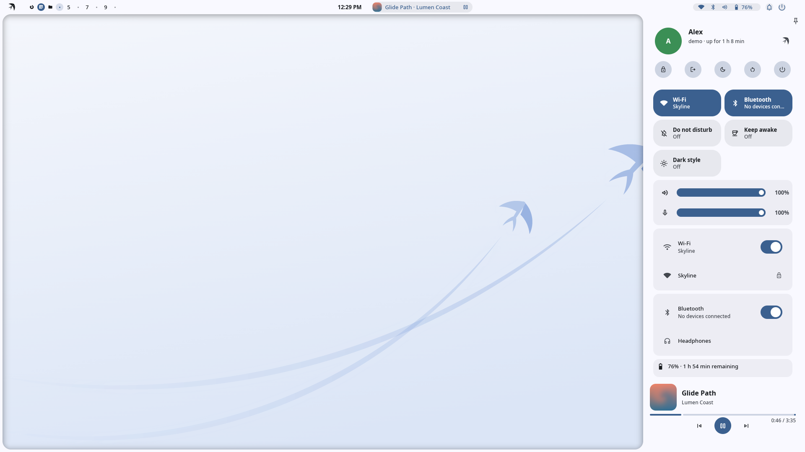
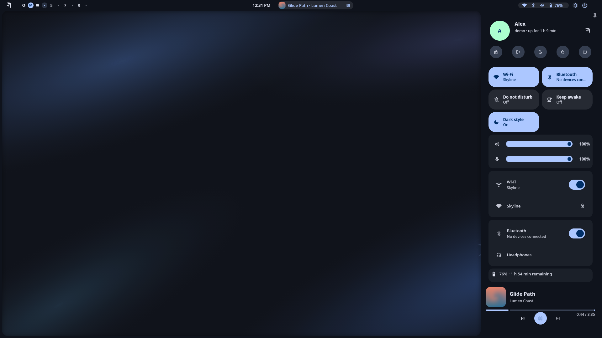
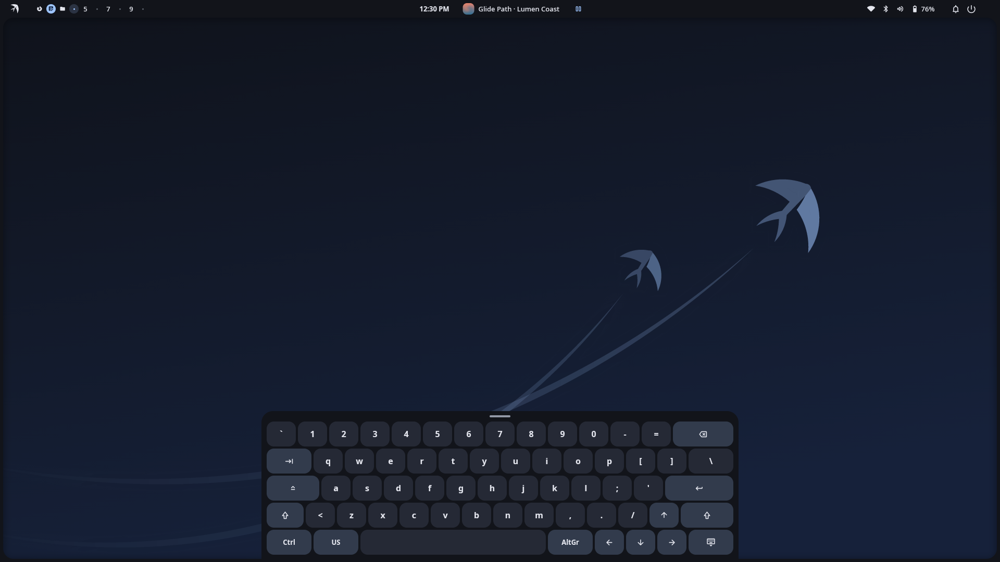
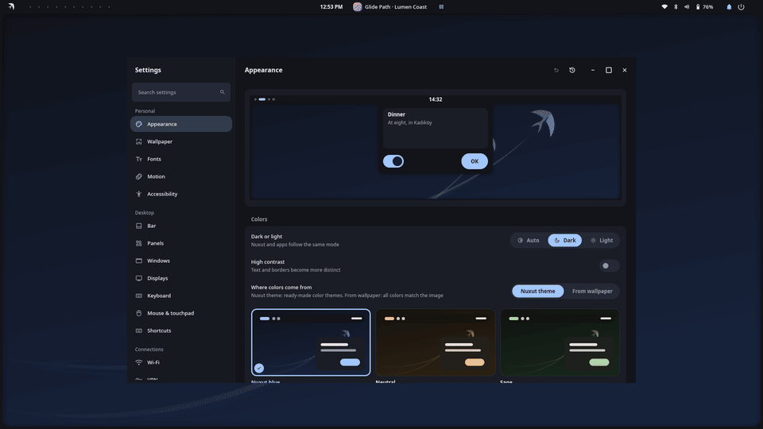

<p align="center">
  
</p>

<h1 align="center">Nuxut Framework</h1>

<p align="center"><em>The penguin can't fly. This one can.</em></p>

The Rust UI framework behind the [Nuxut](https://github.com/nuxut/shell) desktop: its own GPU
renderer, a Wayland runtime, theming, physics-based motion and a component library.

<p align="center">
  
  
  
</p>

<p align="center">
  
</p>

> **Status:** pre-release; the API changes as the shell and apps grow.

## What's inside

| Crate | Purpose |
|---|---|
| `nuxut-core` | geometry and color |
| `nuxut-motion` | analytic springs, curves, deformation |
| `nuxut-config` | TOML loading, validation and live reload |
| `nuxut-theme` | `framework.toml` schema to theme tokens |
| `nuxut-render` | OpenGL ES renderer, painter, text (cosmic-text) |
| `nuxut-wayland` | runtime: layer-shell, xdg-toplevel, EGL, input, event loop |
| `nuxut-ui` | components: buttons, lists, sliders, grids, text input, … |
| `nuxut-i18n`, `nuxut-locale` | Fluent catalogs, locale-aware formatting |
| `nuxut-image`, `nuxut-image-sandbox` | image and icon loading; untrusted images are decoded in a locked-down worker process |
| `nuxut-access` | accessibility (AccessKit) |
| `nuxut-net` | SSRF-resistant HTTP client (address classification, DNS pinning) |
| `nuxut-portal`, `nuxut-video`, `nuxut-palette`, `nuxut-apply` | portal client, video wallpapers (libmpv), Material You palettes from wallpapers, safe atomic edits of external config with snapshots |
| `nuxut` | the facade crate applications depend on |

Design language: [docs/DESIGN.md](docs/DESIGN.md) · Architecture:
[docs/ARCHITECTURE.md](docs/ARCHITECTURE.md) · Decisions: [docs/decisions/](docs/decisions/)
(documents are in Turkish).

## Building

```sh
git clone https://github.com/nuxut/framework.git
cd framework
cargo build --release
cargo run --release -p nuxut-ui --features brand --example gallery
```

To install the whole desktop, use the installer in
[nuxut/shell](https://github.com/nuxut/shell).

## Türkçe

Nuxut masaüstünün Rust arayüz çerçevesi: kendi GPU çizicisi, Wayland çalışma zamanı, tema,
fizik tabanlı hareket ve bileşen kütüphanesi. Belgeler Türkçedir (`docs/`). Lisans: MIT.

## Contributing and security

See [CONTRIBUTING.md](CONTRIBUTING.md) and [SECURITY.md](SECURITY.md).

## License

[MIT](LICENSE) © 2026 Hakan Göksu
